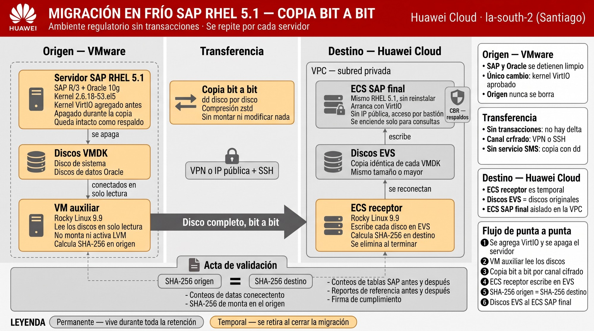

# Plan de la prueba de concepto: migración en frío de RHEL 5.1 a Huawei Cloud vía OBS

Laboratorio para validar, antes de tocar los servidores del cliente, el método de migración de los servidores SAP R/3 sobre **RHEL 5.1** (`2.6.18-53.el5`) desde el VMware de GesNet hacia **Huawei Cloud `la-south-2` (Santiago)**, **sin usar el servicio SMS**.



> El diagrama muestra el **flujo de producción** y se genera con el prompt [`doc/prompt-diagrama-migracion-rhel51.txt`](doc/prompt-diagrama-migracion-rhel51.txt). Este plan lo **simula paso a paso**: el notebook hace de GesNet y una cuenta de Huawei Cloud hace de destino.

---

## 1. Objetivo

Demostrar, con evidencia, que un servidor RHEL 5.1 se puede:

1. **Preparar con drivers VirtIO** sin reinstalar ni actualizar el sistema operativo.
2. **Exportar en frío** sus discos en OVF (un VMDK por disco) y **subirlos a un bucket OBS privado** con `obsutil` y una credencial temporal.
3. **Escribirlos en discos EVS** desde un ECS receptor que descarga de OBS por la red interna, sin IP pública, con `qemu-img`.
4. **Verificar la integridad** comparando el SHA-256 calculado en origen con el calculado en destino.
5. **Arrancar en un ECS** el mismo RHEL 5.1, con sus discos, LVM, red y **la misma IP privada**.
6. **Volver atrás** sin pérdida: el origen queda apagado e intacto.

Y además **medir la velocidad real** de cada tramo (subida a OBS y escritura en EVS) para estimar las ventanas de los servidores reales.

### Fuera de alcance

- No se simula base de datos (Oracle) ni SAP. Los "conteos de tablas" y "reportes de referencia" del acta se sustituyen por archivos de prueba con su SHA-256.
- No se usa el servicio SMS, RMAN, Data Guard ni importación de imágenes IMS.
- No se simula la VPN ni el Direct Connect de Integratel: el acceso al ECS final se valida desde dentro de la VPC.

---

## 2. Correspondencia producción ↔ laboratorio

| Paso en producción (diagrama) | Quién | Cómo se simula en el laboratorio |
|---|---|---|
| Servidor SAP RHEL 5.1 en el VMware de GesNet | GesNet | VM `rhel51-origen` en VMware Workstation, RHEL 5.1 x86_64 oficial |
| Kernel VirtIO agregado antes | Integrador | Variantes A y B sobre snapshots (§5) |
| Se apaga | GesNet | `poweroff` dentro de la VM |
| Exportación OVF, un VMDK por disco | GesNet | `ovftool` (incluido en VMware Workstation) |
| Calcula SHA-256 en origen | GesNet | SHA-256 de cada VMDK exportado **y** del contenido crudo de cada disco (§6, Fase 4) |
| Sube con `obsutil` por HTTPS + credencial temporal | GesNet | `obsutil` en Windows con credencial temporal limitada a subir al bucket |
| Bucket OBS privado y cifrado, GesNet solo puede subir | Huawei | Bucket privado con cifrado del lado servidor y política de solo escritura para la credencial de subida |
| ECS receptor descarga por red interna, sin IP pública | Huawei | ECS Rocky Linux 9.9 **sin EIP**, accede a OBS por la red interna de la región |
| Lo escribe en EVS con `qemu-img` | Huawei | `qemu-img convert -O raw` de cada VMDK a su EVS |
| Calcula SHA-256 en destino | Huawei | SHA-256 de cada EVS sobre exactamente el tamaño virtual del VMDK |
| Discos EVS se reconectan al ECS SAP final | Huawei | Se desconectan del receptor y se conectan al ECS final |
| Conserva su IP privada original | Huawei | Subred de la VPC con el mismo rango que la red de VMware y la misma IP fija |
| CBR — respaldos | Huawei | Opcional: una copia CBR del ECS final y su restauración |
| Acta de validación | Integrador | `evidencia/acta-<variante>.md` |
| Origen queda intacto como respaldo | GesNet | Se vuelve a arrancar `rhel51-origen` y se compara con la línea base |

### Decisiones tomadas

| # | Tema | Decisión |
|---|---|---|
| 1 | Sistema origen | **RHEL 5.1 x86_64 oficial** (ISO de Red Hat, suscripción de desarrollador), kernel `2.6.18-53.el5`. No hay VM del cliente disponible |
| 2 | Drivers VirtIO | **Probar las dos variantes** y elegir la mejor con criterios objetivos (§5) |
| 3 | Canal de transferencia | **OBS**: subida por HTTPS con credencial temporal; descarga por red interna. Sin EIP en ningún ECS |
| 4 | Escritura en EVS | **`qemu-img convert`** de VMDK a crudo, directo al dispositivo |
| 5 | Receptor | **ECS receptor separado** del ECS final; se elimina al terminar |
| 6 | IP | El ECS final conserva **la misma IP privada** que tenía en VMware |
| 7 | Alcance | **Simulación completa**: exportación, subida, escritura, hashes, arranque, acta, vuelta atrás y medición |
| 8 | Base de datos | **No se simula** |
| 9 | Repositorio | `legacy-sap-coldcopy-poc` |
| 10 | Construcción del ambiente | **GitHub Actions + Terraform con OIDC** (sin AK/SK en GitHub), Enterprise Project `default`, construir y destruir por corrida (§7) |

---

## 3. Arquitectura del laboratorio

```
 NOTEBOOK = "GesNet" (VMware Workstation)          HUAWEI CLOUD la-south-2
 ┌──────────────────────────────────┐              ┌────────────────────────────────────────────────┐
 │ rhel51-origen  RHEL 5.1          │              │                    ┌ VPC (mismo rango que VMware)┐
 │  kernel 2.6.18-53.el5 + VirtIO   │              │                    │  ┌──────────────┐           │
 │  IP fija 192.168.63.50           │              │                    │  │ ECS SAP final│ misma IP  │
 │        │ se apaga                │              │                    │  │ RHEL 5.1     │──CBR (opc)│
 │        ▼                         │              │                    │  └──────▲───────┘           │
 │ Discos VMDK (sistema + datos)    │              │                    │         │ se reconectan     │
 │        │ ovftool                 │              │                    │  ┌──────┴───────┐           │
 │        ▼                         │   HTTPS +    │  ┌────────────┐    │  │ Discos EVS   │           │
 │ Exportación OVF + SHA-256 origen │══credencial══│═▶│ Bucket OBS │══▶ │  └──────▲───────┘           │
 │        obsutil                   │   temporal   │  │ privado    │red │         │ qemu-img          │
 └──────────────────────────────────┘              │  └────────────┘int.│  ┌──────┴───────┐           │
                                                   │                    │  │ ECS receptor │ SHA-256   │
                                                   │                    │  │ Rocky 9.9    │ destino   │
                                                   │                    │  └──────────────┘           │
                                                   │                    └─────────────────────────────┘
                                                   └────────────────────────────────────────────────┘
```

### Componentes

| Dónde | Componente | Detalle |
|---|---|---|
| Notebook | VMware Workstation Pro 26 | Corre sobre Hyper-V. Incluye `ovftool` 9.1 |
| Notebook | `rhel51-origen` | RHEL 5.1 x86_64 instalado con [`scripts/origen/rhel51-origen-ks.cfg`](scripts/origen/rhel51-origen-ks.cfg). Disco de sistema 12 GB (LVM `VolGroup00`) + disco de datos 4 GB (LVM `VolGroupDatos`). Controladora LSI Logic y NIC e1000, como en un VMware de esa época. Snapshot base antes de cualquier cambio |
| Notebook | `obsutil` | Sube los VMDK al bucket con la credencial temporal (variables de entorno) |
| Huawei | Bucket OBS | Privado, cifrado del lado servidor, mismo `la-south-2`. Política: la credencial de subida solo puede `PutObject`; el receptor solo puede leer |
| Huawei | VPC + subred | Mismo rango que la red NAT de VMware (`192.168.63.0/24`) para conservar la IP |
| Huawei | ECS receptor | Rocky Linux 9.9 (imagen pública), **sin EIP**. Lee OBS por la red interna con una agencia IAM (sin AK/SK en el ECS). Temporal |
| Huawei | EVS | Uno por cada VMDK, mismo tamaño o mayor, **misma zona de disponibilidad** que ambos ECS |
| Huawei | ECS SAP final | Se crea, se apaga, se le quita el disco de sistema y recibe los EVS. **Sin EIP**, IP fija igual a la de origen |
| Huawei | CBR (opcional) | Una copia del ECS final para validar respaldo y restauración |

---

## 4. Prerrequisitos

| # | Prerrequisito | Responsable | Estado |
|---|---|---|---|
| P1 | VMware Workstation Pro instalado | Alejandro | Listo (2026-11-18) |
| P2 | ISO oficial RHEL 5.1 x86_64 (Binary DVD, SHA-256 publicado por Red Hat) | Claude, con la cuenta de Alejandro | Listo (2026-11-18): `rhel-5.1-server-x86_64-dvd.iso`, SHA-256 verificado |
| P3 | `rhel51-origen` reducida: disco de sistema + disco LVM pequeño, sin datos productivos | Claude | Listo (2026-11-18): RHEL 5.1 instalado, IP `192.168.63.50`, snapshot `base` |
| P4 | ~~`aux-copia` con Rocky Linux 9.9~~ | Claude | Retirada (2026-11-18): el hash crudo se calcula en Windows con `vmware-vdiskmanager` (Fase 4) |
| P5 | AK/SK de administrador **solo para el bootstrap OIDC** (una vez, en local, variables de entorno). Después GitHub se federa por OIDC y no guarda ninguna AK/SK | Alejandro | Listo (2026-11-18): bootstrap aplicado |
| P6 | Cuota en `la-south-2` para 2 ECS, 4 EVS, 1 bucket OBS, 1 agencia IAM (no se necesita EIP). Bucket de estados `obs-terraform-tfstate` existente (compartido con `nextcloud-huawei`) | Alejandro | Listo (2026-11-18): el deploy no encontró límites |
| P10 | Repositorio GitHub `alejandromore/legacy-sap-coldcopy-poc` con el environment `huawei-lab` y sus variables `HW_IDP_ID` y `HW_DOMAIN_NAME` | Claude | Listo (2026-11-18) |
| P7 | Paquetes para las variantes VirtIO (§5) | Claude | Listo (2026-11-18) |
| P8 | `obsutil` para Windows (descarga oficial de Huawei Cloud) | Claude, con confirmación de descarga | Pendiente |
| P9 | Credencial temporal de subida (AK/SK temporal + token de seguridad) limitada a `PutObject` en el bucket | Alejandro | Pendiente (se genera en la Fase 3) |

---

## 5. Drivers VirtIO: dos variantes, se elige la mejor

RHEL 5.1 (`2.6.18-53.el5`) **no trae VirtIO**; RHEL lo incorporó en 5.3 (`2.6.18-128.el5`). Sin VirtIO, el ECS no ve sus discos ni su red. Se prueban dos variantes, cada una **sobre su propio snapshot** de `rhel51-origen`, partiendo del mismo snapshot base. Este es el "Kernel VirtIO agregado antes" del diagrama: el único cambio aprobado en el origen.

| | Variante A — kernel adicional | Variante B — backport `kmod-virtio` |
|---|---|---|
| Qué se hace | Instalar el paquete de kernel de la serie RHEL 5.11 (`2.6.18-419.el5`) **al lado** del original, con su propia entrada de GRUB | Compilar `virtio`, `virtio_ring`, `virtio_pci`, `virtio_blk`, `virtio_net` para `2.6.18-53.el5` a partir de las fuentes de RHEL 5.3, en una copia aislada, y copiar solo los `.ko` |
| Qué no cambia | `glibc 2.5`, librerías, kernel original (queda como entrada por defecto en VMware) | Kernel, `glibc`, librerías |
| Archivos tocados | `/boot` (kernel + initrd nuevos), `/lib/modules/2.6.18-419.el5`, `grub.conf` | `/lib/modules/2.6.18-53.el5/extra/virtio/`, initrd paralelo, `grub.conf` |
| Origen del binario | Paquete oficial de Red Hat (en producción: suscripción del cliente) | Compilado por nosotros |

### Criterios de elección

| Criterio | Peso | Cómo se mide |
|---|---|---|
| Arranca en el ECS y ve discos y red | Excluyente | Consola VNC, `fdisk -l`, `ifconfig`, `ping` al gateway |
| Estabilidad | Alto | 5 reinicios seguidos sin errores; escritura y lectura sostenida con `dd` de varios GB sin errores en `dmesg` |
| Defendible ante cumplimiento | Alto | Binario firmado por el fabricante vs compilado propio |
| Cambios en el sistema | Medio | Cantidad de archivos nuevos o modificados (`find -newer` contra el snapshot base) |
| Reversibilidad | Medio | Volver a arrancar en VMware con la entrada original y ver que todo funciona igual |
| Esfuerzo para repetir en 4 servidores | Medio | Pasos y tiempo por servidor |

La variante elegida se documenta en `evidencia/decision-virtio.md`.

### Preparación común (ambas variantes)

- `fstab` y `grub.conf` por `LABEL` o `UUID`, no por `/dev/sdX` (en el ECS serán `/dev/vdX`).
- `lvm.conf`: incluir `types = [ "virtblk", 16 ]`.
- Quitar `HWADDR` de `ifcfg-eth0` y desactivar `kudzu`, para que la NIC nueva tome la configuración.
- IP fija en `ifcfg-eth0` (la que se conservará en Huawei).
- Entrada de GRUB para Huawei con `clocksource=acpi_pm`; la entrada original sigue siendo la predeterminada en VMware.
- Consola serie habilitada (`console=tty0 console=ttyS0,115200`) para ver el arranque desde la consola del ECS.

---

## 6. Fases

### Fase 0 — Repositorio y entorno
- Estructura del repositorio y `.gitignore` (excluir `*.tfstate`, `*.vmdk`, `*.ovf`, `*.iso`, llaves y `terraform.tfvars`). **Listo.**
- VMware Workstation (P1). **Listo.**
- Instalar `rhel51-origen` con RHEL 5.1 oficial (P2, P3) y fijar su IP (`192.168.63.50`). **Listo**: `redhat-release-5Server-5.1.0.2`, kernel `2.6.18-53.el5`, 408 paquetes, `VolGroup00` (sistema) y `VolGroupDatos` (`/datos`), SSH solo con llave RSA.
- **Snapshot base** de `rhel51-origen`. **Listo** (snapshot `base`, ISOs desconectadas).

### Fase 1 — Línea base del origen ("antes")
- Script `scripts/origen/inventario.sh` (compatible con bash 3.2 de RHEL 5): `uname -a`, `fdisk -l`, `pvs`/`vgs`/`lvs`, `df -h`, `fstab`, `grub.conf`, `lsmod`, `ifcfg-*`.
- Generar archivos de prueba en el disco LVM de datos con su lista de SHA-256 (sustituye a los conteos de tablas y reportes SAP).
- Guardar todo en `evidencia/antes/`.
- **Estado (2026-11-18): listo.** [`generar-datos-prueba.sh`](scripts/origen/generar-datos-prueba.sh) creó 18 archivos (1.1 GB: 13 binarios aleatorios y 5 "tablas" CSV con conteos conocidos) en `/datos/prueba` con su manifiesto `SHA256SUMS`. [`inventario.sh`](scripts/origen/inventario.sh) quedó en [`evidencia/antes/inventario.txt`](evidencia/antes/inventario.txt) (408 paquetes, 18 archivos OK). Snapshot `linea-base` tomado con la VM apagada: es el punto de partida de las dos variantes VirtIO.

### Fase 2 — Variantes VirtIO
- Variante A sobre snapshot `virtio-A`; variante B sobre snapshot `virtio-B` (§5), ambas partiendo de `linea-base`.
- **Variante A (2026-11-18): lista.** [`preparar-virtio-A.sh`](scripts/origen/preparar-virtio-A.sh) instaló `kernel-2.6.18-419.el5` (rebuild CentOS 5.11, firma GPG verificada; en producción, el paquete de Red Hat) sin cambiar el predeterminado, armó su initrd con `virtio_pci`, `virtio_blk` y `mptspi`, y aplicó la preparación común. Probado en VMware: los dos kernels arrancan con LVM, `/datos`, red y los 18 archivos de prueba OK. Cambios propios: `lvm.conf`, `sysconfig/kernel`, `ifcfg-eth0`, `grub.conf` y el kernel ([`evidencia/virtio-A/cambios.txt`](evidencia/virtio-A/cambios.txt)). Snapshot `virtio-A` con la entrada original como predeterminada.
- Antes de exportar (Fase 4), la entrada VirtIO pasa a ser la predeterminada (`default=0`): el ECS no tiene quién elija en el menú de GRUB. En VMware sigue arrancando, porque su initrd también trae `mptspi`.
- En cada una: comprobar que **sigue arrancando en VMware** con la entrada original.

### Fase 3 — Construcción del ambiente Huawei (ver §7)
- Bootstrap OIDC (una vez) y luego workflow `ambiente` con `action=plan`, revisión del plan, y `action=deploy`, `etapa=recepcion`.
- Credencial de subida: credencial temporal (AK/SK temporal + token) emitida con una **política reducida a `PutObject` en `incoming/`**, para `obsutil`. Es lo mismo que en producción se le entrega a GesNet.
- **Validar temprano** (antes de la Fase 4): que el receptor sin EIP alcanza OBS por la red interna y que el cloud-init instaló `qemu-img` y `obsutil` (`/var/log/coldcopy-bootstrap.log`, por consola VNC).
- **Estado (2026-11-18):** desplegado con `deploy`/`recepcion` ([run 44444599543](https://github.com/alejandromore/legacy-sap-coldcopy-poc/actions/runs/44444599543)), 15 recursos. Huawei aceptó el gateway `.2`. Receptor en `192.168.63.159` con los EVS `sistema` (40 GB) y `datos` (10 GB); ECS SAP final apagado en `192.168.63.50`; bucket `obs-legacy-coldcopy-vmdk`. Pendiente: validar cloud-init y acceso a OBS del receptor por VNC.

### Fase 4 — Exportación y subida (rol de GesNet, por cada variante)
1. Dejar la entrada VirtIO como predeterminada en `grub.conf` y apagar `rhel51-origen` (`poweroff`).
2. Exportar con `ovftool` a `export/<variante>/`: un `.ovf` + un VMDK por disco.
3. SHA-256 de cada archivo VMDK exportado (`Get-FileHash`): verifica el tramo de transferencia.
4. SHA-256 del **contenido crudo** de cada disco: `vmware-vdiskmanager -r <exportado>.vmdk -t 4 crudo.vmdk` genera un disco preallocated cuyo `crudo-flat.vmdk` es la imagen cruda, y `Get-FileHash -Algorithm SHA256` sobre ese archivo da el "SHA-256 origen" del acta. Se calcula sobre el VMDK exportado, no sobre el original, para validar también la exportación.
5. Subir con `obsutil cp` usando la credencial temporal; registrar duración y velocidad.
6. Comprobar que la credencial de subida **no puede** listar, leer ni borrar objetos.

### Fase 5 — Recepción y escritura (rol de Huawei)
1. En el receptor, descargar cada VMDK desde OBS por la red interna; SHA-256 del archivo = SHA-256 del paso 4.3.
2. `qemu-img convert -p -O raw disco.vmdk /dev/vdX` a su EVS.
3. SHA-256 del EVS sobre exactamente el tamaño virtual del VMDK (el EVS puede ser mayor): es el "SHA-256 destino".
4. Registrar duración y velocidad de descarga y de escritura.
5. Las salidas (hashes, tiempos, logs) se suben a `resultados/` en el bucket para traerlas al repositorio.

### Fase 6 — Armado del ECS SAP final
1. Workflow `ambiente` con `action=deploy`, `etapa=final`: elimina el receptor y deja los EVS libres. El ECS final ya existe, apagado y con la IP de origen.
2. Desconectar el disco de sistema provisorio del ECS final y conectar los EVS: el de sistema como disco de sistema y los de datos en el mismo orden (script `scripts/huawei/armar-final.py` en un workflow, por pendiente).
3. Encender: arranca la entrada VirtIO, predeterminada desde la Fase 4.
4. Verificar: arranque, LVM, montajes, **misma IP**, `ping` y SSH desde el receptor (simula el acceso de Integratel), y SHA-256 de los archivos de prueba contra la lista de la Fase 1.
5. Opcional: copia CBR del ECS final y restauración de prueba.

### Estado de las Fases 4 a 6 — variante A (2026-11-19)

**Completas.** Acta: [`evidencia/acta-A.md`](evidencia/acta-A.md).

- SHA-256 origen = destino en los 2 discos.
- RHEL 5.1 arranca en el ECS con VirtIO, conserva la IP `192.168.63.50` y los 18 archivos de prueba dan OK.

Ajustes que salieron de la prueba y ya están en el código:

1. **Disco de sistema desde imagen.** Huawei no acepta como disco de sistema un EVS creado vacío. El disco de sistema tiene que ser un EVS creado desde una imagen, sobre el que el receptor escribe tras ponerlo en cero (opción `limpiar` del manifiesto). En esta corrida se reutilizó el disco de sistema original del ECS final. Pendiente: que Terraform cree el EVS `sistema` con `image_id`.
2. **Nombres de dispositivo.** En KVM los discos se conectan como `/dev/vda` y `/dev/vdb` ([`scripts/huawei/armar-final.py`](scripts/huawei/armar-final.py)).
3. **Permisos de la agencia.** Necesitó `OBS OperateAccess`, porque el rol personalizado acotado al bucket no tuvo efecto. Pendiente acotarlo.
4. **Receptor sin Internet.** Sin `qemu-img`, usa un agente en Python con biblioteca estándar ([`scripts/receptor/coldcopy-receptor.py`](scripts/receptor/coldcopy-receptor.py)) que:
   - lee OBS con las credenciales de la agencia;
   - escribe los EVS con su propio conversor de VMDK;
   - publica los resultados;
   - verifica el ECS final por SSH.
5. **Diagnóstico sin SSH.** La consola serie del ECS (API `os-getConsoleOutput`) es la única ventana; ahí escriben el agente y el kernel del RHEL.
6. **Credencial de subida.** La credencial temporal reducida dejó de ser válida antes de su vencimiento. Se volvió a emitir sin problemas.

### Fase 7 — Acta de validación
- `evidencia/acta-<variante>.md`, con la misma estructura que el acta del diagrama:
  - SHA-256 origen = SHA-256 destino, por disco.
  - Contenido de cada EVS igual a su VMDK.
  - Archivos de prueba antes y después (en lugar de conteos de tablas y reportes SAP).
  - Inventario antes y después, capturas de consola, velocidades medidas.

### Fase 8 — Vuelta atrás
- Encender `rhel51-origen` en VMware con la entrada original y repetir el inventario: debe ser idéntico al de la Fase 1. El origen nunca se borra.

### Fase 9 — Medición y extrapolación
- Con las velocidades medidas (GB/h) de subida a OBS, descarga y escritura en EVS, estimar la ventana de cada servidor real (6.5 TB, 4.5 TB, 1.75 TB, 500 GB), sumando exportación OVF y hashes.
- Nota: el enlace del notebook no es el del centro de datos de GesNet; la medición valida el método y el cálculo, no la velocidad final.

### Fase 10 — Cierre
- Workflow `ambiente` con `action=destroy` (§7): borra todo, incluido el bucket con su contenido, y falla si queda algo en el estado.
- Revisar en la consola de facturación que no quedan ECS, EVS, OBS ni copias CBR. Las credenciales temporales expiran solas.
- Elegir la variante VirtIO y dejar el procedimiento final en `doc/procedimiento.md`.
- El proveedor OIDC y su grupo se conservan para la siguiente corrida; para retirarlos, `terraform destroy` en `terraform/bootstrap` (local).

---

## 7. Construcción y destrucción del ambiente

Todo el ambiente de Huawei se crea y se destruye desde GitHub Actions, **sin AK/SK guardadas en GitHub**: el job se federa por **OIDC** con IAM y recibe credenciales temporales (2 horas). Todos los recursos van al **Enterprise Project `default`** (`enterprise_project_id = "0"`). El estado vive en `obs-terraform-tfstate/legacy-sap-coldcopy.tfstate`. Mismo patrón que `nextcloud-huawei` (backend s3 sobre OBS, workflow manual con `concurrency`), cambiando AK/SK por OIDC.

### Paso 0 — Bootstrap OIDC (una sola vez, en local)

`terraform/bootstrap/` se aplica con las AK/SK de administrador en variables de entorno (P5) y crea:

| Recurso | Detalle |
|---|---|
| Proveedor de identidad `github-legacy-coldcopy` | OIDC, acceso programático, confía en `token.actions.githubusercontent.com` con audiencia `huaweicloud`. Clave de firma = JWKS publicado por GitHub |
| Regla de conversión | Solo el claim `sub` = `repo:alejandromore/legacy-sap-coldcopy-poc:environment:huawei-lab` se convierte en el usuario federado `github-legacy-coldcopy` |
| Grupo `grp-legacy-coldcopy-github` | Tenant Administrator (todos los proyectos) + Security Administrator (para la agencia y el rol del receptor). Suficiente para laboratorio; en producción se reduce por servicio |

```powershell
$env:HW_ACCESS_KEY="..."; $env:HW_SECRET_KEY="..."; $env:AWS_ACCESS_KEY_ID=$env:HW_ACCESS_KEY; $env:AWS_SECRET_ACCESS_KEY=$env:HW_SECRET_KEY; $env:TF_VAR_domain_id="..."; $env:AWS_REQUEST_CHECKSUM_CALCULATION="when_required"; $env:AWS_RESPONSE_CHECKSUM_VALIDATION="when_required"
terraform -chdir=terraform/bootstrap init
terraform -chdir=terraform/bootstrap apply
```

Su output `idp_id` va a la variable `HW_IDP_ID` del environment `huawei-lab`. Después se borran las AK/SK de la sesión.

**Estado:** aplicado el 2026-11-18. `HW_IDP_ID = github-legacy-coldcopy` y `HW_DOMAIN_NAME` cargadas en el environment `huawei-lab`.

### Workflow `ambiente` (`.github/workflows/ambiente.yml`)

1. `id-token: write` → GitHub emite un JWT con audiencia `huaweicloud`.
2. [`.github/actions/huawei-oidc`](.github/actions/huawei-oidc/action.yml) lo canjea en IAM (`/v3.0/OS-AUTH/id-token/tokens`) por un token federado y este por AK/SK temporal + security token (`/v3.0/OS-CREDENTIAL/securitytokens`), enmascarados.
3. Terraform usa `HW_*` (provider) y `AWS_*` + `AWS_SESSION_TOKEN` (backend en OBS).

| Entrada | Valores | Efecto |
|---|---|---|
| `action` | `plan` | Muestra los cambios sin aplicar |
| | `deploy` | Construye o actualiza el ambiente |
| | `destroy` | Destruye todo y verifica que el estado quede vacío |
| `etapa` | `recepcion` | Receptor encendido con los EVS conectados (Fases 3 a 5) |
| | `final` | Receptor eliminado, EVS libres, ECS final listo para recibirlos (Fase 6) |

### Recursos que crea `terraform/`

| Archivo | Recursos |
|---|---|
| `01-red.tf` | VPC `192.168.0.0/16`, subred `192.168.63.0/24` con gateway `.2` (igual que VMware NAT), security group sin entradas desde Internet |
| `02-obs.tf` | Bucket `obs-legacy-coldcopy-vmdk`: privado, SSE-OBS, sin versionado, `force_destroy` |
| `03-iam.tf` | Rol `custom-legacy-coldcopy-receptor-obs` (leer `incoming/`, escribir `resultados/`) y agencia del receptor |
| `04-ecs.tf` | ECS receptor Rocky Linux 9.9 sin EIP, con la agencia y cloud-init (`qemu-img`, `obsutil`); ECS SAP final apagado con IP fija `192.168.63.50` |
| `05-evs.tf` | Un EVS por VMDK (`sistema` 40 GB, `datos` 10 GB) y su conexión al receptor en la etapa `recepcion` |

### Ciclo de vida

```
bootstrap (1 vez) ─▶ plan ─▶ deploy/recepcion ─▶ Fases 4-5 ─▶ deploy/final ─▶ Fase 6-8 ─▶ destroy
                                                                                          │
                                       variante B: deploy/recepcion de nuevo ◀────────────┘
```

Cada variante VirtIO puede correr en un ambiente nuevo (destroy y deploy) para que sus EVS partan vacíos.

---

## 8. Criterios de éxito

- [ ] RHEL 5.1 arranca en el ECS final con la variante elegida.
- [ ] SHA-256 origen = SHA-256 destino en el **100 %** de los discos.
- [ ] La credencial de subida solo puede subir; el bucket es privado y cifrado.
- [ ] Ningún ECS tuvo IP pública; el receptor leyó OBS por la red interna.
- [ ] LVM, montajes y red operativos en el ECS final, **con la misma IP** que en VMware.
- [ ] Los SHA-256 de los archivos de prueba coinciden con la línea base.
- [ ] El origen arranca igual en VMware después de todo (vuelta atrás).
- [ ] Velocidades medidas y ventanas estimadas para los 4 servidores.
- [ ] Infraestructura destruida y sin cargos pendientes.

---

## 9. Riesgos del laboratorio

| Riesgo | Mitigación |
|---|---|
| El VMDK exportado (OVF, formato comprimido) no tiene el mismo hash de archivo que el disco original | Se comparan dos hashes distintos: el del archivo (transferencia) y el del contenido crudo (integridad del disco). El acta usa el del contenido |
| El receptor sin EIP no alcanza OBS o los repositorios | Validarlo en la Fase 3; alternativa: NAT Gateway temporal, o subir el RPM de `qemu-img` al bucket |
| La agencia IAM no sirve con `obsutil` en el receptor | Alternativa: credencial temporal de solo lectura, ingresada por consola VNC y nunca guardada en disco |
| No se puede usar un EVS de datos como disco de sistema | Validarlo temprano en la Fase 6 |
| El gateway de la subred de Huawei (`.1`) difiere del de VMware NAT (`.2`) | Ajustar `GATEWAY` en la entrada de GRUB/red de Huawei o fijar el gateway de la subred; documentar la diferencia para producción |
| Kernel 2.6.18 inestable en el flavor elegido | Probar con flavor de pocas vCPU; registrar el flavor que funciona |
| Costos olvidados en Huawei | Workflow `destroy` (verifica estado vacío) y revisión de la consola de facturación |
| GitHub rota sus claves de firma OIDC y IAM rechaza el token | Volver a aplicar `terraform/bootstrap` (relee el JWKS) |
| El backend s3 de OBS no acepta el security token temporal | Validarlo en el primer `plan`; alternativa: estado local cifrado como artifact o AK/SK de un usuario de solo estado |
| El grupo federado tiene permisos amplios | Solo lo usa el environment `huawei-lab` de este repositorio (claim `sub`); proteger el environment con aprobación manual |
| Llaves, AK/SK o credenciales temporales en el repositorio | `.gitignore` y variables de entorno; revisar antes de cada commit |

---

## 10. Estructura prevista del repositorio

```
legacy-sap-coldcopy-poc/
├── README.md
├── PLAN.md                       # este documento
├── doc/
│   ├── diagrama-migracion-rhel51.jpg
│   ├── prompt-diagrama-migracion-rhel51.txt
│   └── procedimiento.md          # procedimiento final (Fase 10)
├── .github/
│   ├── actions/huawei-oidc/      # canje OIDC -> AK/SK temporal
│   └── workflows/ambiente.yml    # plan / deploy / destroy
├── terraform/                    # OBS, IAM, VPC, SG, ECS receptor, EVS, ECS final
│   ├── bootstrap/                # proveedor OIDC + grupo (una vez, local)
│   └── templates/                # cloud-init del receptor
├── scripts/
│   ├── origen/                   # kickstart, inventario.sh, preparar-virtio-A.sh, preparar-virtio-B.sh
│   ├── exportacion/              # exportar-ovf.ps1, hash-crudo.sh, subir-obs.ps1 (rol GesNet)
│   ├── receptor/                 # escribir-evs.sh (obsutil + qemu-img + SHA-256)
│   └── huawei/                   # armar-final.py (cambio de disco de sistema, Fase 6)
└── evidencia/                    # antes/, despues/, acta-A.md, acta-B.md, decision-virtio.md
```
