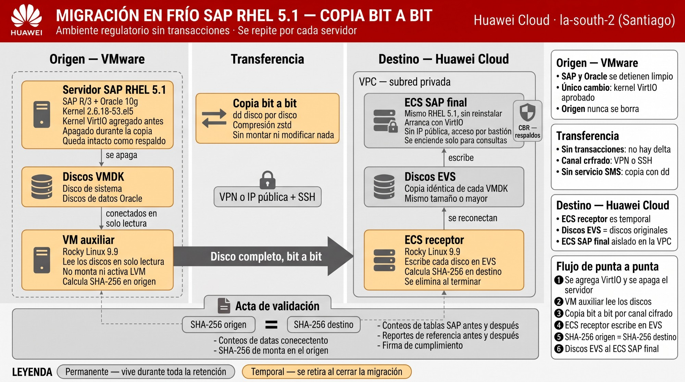

# Guía de implementación — Migración en frío de servidores SAP RHEL 5.1 a Huawei Cloud vía OBS

**Origen:** VMware de GesNet · **Destino:** Huawei Cloud `la-south-2` (Santiago) · **Usuarios:** Integratel



Esta guía describe, paso a paso y por responsable, cómo migrar **un** servidor SAP R/3 + Oracle 10g sobre **RHEL 5.1** (`2.6.18-53.el5`) desde el VMware de GesNet hacia Huawei Cloud **sin reinstalar el sistema y sin el servicio SMS**. El mismo procedimiento se repite por cada servidor.

El método se validó en laboratorio con un RHEL 5.1 oficial ([`PLAN.md`](PLAN.md), [`evidencia/acta-A.md`](../evidencia/acta-A.md)). Resultado:

- SHA-256 de origen igual al de destino en el 100 % de los discos.
- El servidor arranca en el ECS con VirtIO, conserva su IP privada y pasa 5 reinicios y escritura sostenida sin errores.
- El origen vuelve a arrancar intacto en VMware.

> **Estado de las opciones VirtIO:** las dos están **validadas de punta a punta** ([`acta-A.md`](../evidencia/acta-A.md), [`acta-B.md`](../evidencia/acta-B.md)).
> - Se recomienda la **A** por cumplimiento (binario firmado por Red Hat).
> - La **B** es la alternativa si no se puede obtener el kernel de Red Hat o si se exige mantener el kernel original.
>
> Decisión: [`decision-virtio.md`](../evidencia/decision-virtio.md).

---

## Índice

1. [Idea del método](#1-idea-del-método)
2. [Responsables](#2-responsables)
3. [Prerrequisitos](#3-prerrequisitos)
4. [Las dos opciones para agregar VirtIO](#4-las-dos-opciones-para-agregar-virtio)
5. [Procedimiento paso a paso](#5-procedimiento-paso-a-paso)
6. [Plan de vuelta atrás](#6-plan-de-vuelta-atrás)
7. [Tiempos y ventana](#7-tiempos-y-ventana)
8. [Lecciones del laboratorio que ya están incorporadas](#8-lecciones-del-laboratorio-que-ya-están-incorporadas)
9. [Acta de validación (plantilla)](#9-acta-de-validación-plantilla)
10. [Anexos](#10-anexos)

---

## 1. Idea del método

El ambiente es regulatorio y no tiene transacciones, así que no hace falta sincronización incremental. El servidor se apaga y se copia en frío, disco por disco y bit a bit:

1. **GesNet** agrega VirtIO al servidor (único cambio aprobado), lo apaga y exporta sus discos en **OVF**, un VMDK por disco. Calcula el **SHA-256 en origen** y sube los VMDK a un **bucket OBS privado** con `obsutil`, por HTTPS y con una credencial temporal que solo permite subir.
2. **Huawei** tiene en la misma VPC un **ECS receptor** sin IP pública. El receptor descarga cada VMDK por la red interna, lo escribe sin cambios en un **disco EVS** y calcula el **SHA-256 en destino**. Si coincide con el de origen, la copia es idéntica y queda como evidencia de auditoría.
3. Los EVS se conectan al **ECS SAP final**, que arranca el **mismo RHEL 5.1** con su **misma IP privada**.
4. **Integratel** valida SAP (conteos y reportes) y sus usuarios acceden por **VPN o Direct Connect**.
5. El servidor de origen queda **apagado e intacto** en GesNet como respaldo, y nunca se borra.

```
GesNet (VMware)                 Huawei Cloud la-south-2
┌─────────────────────┐         ┌───────────────────────────────────────────────────────────┐
│ Servidor SAP RHEL5.1│         │                        ┌ VPC (misma subred que GesNet) ─┐ │
│  + VirtIO, apagado  │         │                        │  ECS SAP final (misma IP)      │ │
│        ↓            │         │                        │        ↑ se reconectan         │ │
│ Discos VMDK         │  HTTPS  │  ┌────────────┐  red   │  Discos EVS                    │ │
│        ↓            │ +cred.  │  │ Bucket OBS │ interna│        ↑ escribe               │ │
│ Exportación OVF ════╪═══════════╪═▶│  privado   │═══════╪═▶ ECS receptor (sin IP pública)│ │
│ SHA-256 origen      │ temporal│  └────────────┘        │  SHA-256 destino               │ │
└─────────────────────┘         │                        └────────────────────────────────┘ │
                                └───────────────────────────────────────────────────────────┘
                                          ▲ VPN o Direct Connect: Integratel
```

---

## 2. Responsables

| Actividad | GesNet | Huawei | Integratel |
|---|---|---|---|
| Autorizar la migración y la ventana | Informado | Informado | **Aprueba** |
| Aprobar el cambio VirtIO (único cambio en el origen) | Ejecuta | Prepara y prueba | **Aprueba** |
| Línea base SAP (conteos de tablas, reportes de referencia) | Apoya | Informado | **Ejecuta** (Basis / funcional) |
| Inventario técnico del origen | **Ejecuta** | Provee el script | Informado |
| Construir el ambiente en Huawei (VPC, OBS, receptor, EVS, ECS final) | — | **Ejecuta** | Informado |
| Emitir la credencial temporal de subida | Recibe | **Ejecuta** | — |
| Detener SAP y Oracle, apagar el servidor | **Ejecuta** | Informado | Aprueba el inicio |
| Exportar OVF, calcular SHA-256 y subir a OBS | **Ejecuta** | Monitorea | — |
| Recepción en EVS y SHA-256 destino | Informado | **Ejecuta** | — |
| Armar y arrancar el ECS SAP final | — | **Ejecuta** | — |
| Validación técnica (inventario, estabilidad) | — | **Ejecuta** | Informado |
| Validación SAP y firma de cumplimiento | — | Apoya | **Ejecuta** |
| Cambiar el acceso de usuarios (VPN o Direct Connect) | Retira la ruta al origen | Configura su lado | **Ejecuta** su lado |
| Respaldos CBR | — | **Ejecuta** | Define la retención |
| Retener el origen apagado | **Ejecuta** | — | Define el plazo |

---

## 3. Prerrequisitos

### 3.1 Integratel

| # | Prerrequisito |
|---|---|
| I-1 | Autorización formal de la migración del servidor, con la ventana de parada acordada (§7) |
| I-2 | Aprobación del cambio VirtIO (opción A o B, §4) como único cambio sobre el origen |
| I-3 | Lista de **conteos de tablas SAP** y **reportes de referencia** que se comparan antes y después (por ejemplo `MARA`, `VBAK`, `VBAP`, `BKPF`, `BSEG` y los reportes regulatorios). Se ejecutan en la Fase 1 y en la Fase 8 |
| I-4 | Suscripción Red Hat vigente con acceso a RHEL 5 (para la opción A, el paquete `kernel-2.6.18-419.el5` firmado por Red Hat) |
| I-5 | Conectividad privada a Huawei Cloud: VPN IPsec o Direct Connect hacia la VPC de destino, con la **misma subred** que hoy usa el servidor en GesNet |
| I-6 | Plazo de retención del servidor de origen apagado en GesNet y política de respaldo en destino (CBR) |

### 3.2 GesNet

| # | Prerrequisito |
|---|---|
| G-1 | Acceso de administrador al vCenter/ESXi donde vive el servidor y a su consola |
| G-2 | `ovftool` (VMware OVF Tool 4.x o superior) en un equipo con acceso al vCenter, o permiso para usar "Export OVF Template" del cliente de vSphere |
| G-3 | Espacio temporal para la exportación: el tamaño **usado** de los discos (el OVF guarda los VMDK comprimidos), más el mismo espacio si se calcula el hash crudo con una imagen intermedia (§5, Fase 4) |
| G-4 | `obsutil` para el sistema operativo del equipo de subida ([descarga oficial de Huawei Cloud](https://support.huaweicloud.com/intl/en-us/utiltg-obs/obs_11_0003.html)) |
| G-5 | Herramienta de SHA-256: `sha256sum` (Linux) o `Get-FileHash` (Windows PowerShell) |
| G-6 | Salida HTTPS (TCP 443) desde el equipo de subida hacia `*.obs.la-south-2.myhuaweicloud.com`. Ancho de banda medido, porque define la ventana (§7) |
| G-7 | Acceso `root` al servidor RHEL 5.1 para aplicar el cambio VirtIO y correr el inventario |

### 3.3 Huawei

| # | Prerrequisito |
|---|---|
| H-1 | Cuenta Huawei Cloud con cuota en `la-south-2`: 2 ECS (receptor y SAP final), un EVS por disco de origen (más el de sistema del receptor), 1 bucket OBS y 1 agencia IAM. **No se necesita EIP** |
| H-2 | Repositorio con este código y un environment de GitHub (`huawei-lab` o el equivalente de producción) con las variables `HW_IDP_ID`, `HW_DOMAIN_NAME` y `HW_DOMAIN_ID` |
| H-3 | Bootstrap OIDC aplicado una vez (§10.2): proveedor de identidad de GitHub en IAM. Con eso ninguna AK/SK queda guardada en GitHub |
| H-4 | Bucket de estados de Terraform (`obs-terraform-tfstate` o equivalente) |
| H-5 | Datos del servidor de origen: cantidad y tamaño de discos, **IP privada**, máscara, gateway y DNS, para replicarlos en la VPC |
| H-6 | Flavor del ECS final equivalente en vCPU y RAM al servidor de origen. Para el kernel 2.6.18 conviene un flavor KVM de uso general (en laboratorio funcionó `s3.large.2`) |

---

## 4. Las dos opciones para agregar VirtIO

RHEL 5.1 **no trae VirtIO**: Red Hat lo incorporó en RHEL 5.3 (`2.6.18-128.el5`). Sin VirtIO el ECS no ve sus discos ni su red. Hay dos formas de agregarlo sin reinstalar ni actualizar el sistema. En las dos, la entrada original de GRUB sigue existiendo y el servidor sigue arrancando en VMware.

| | **Opción A — kernel adicional** (validada, recomendada) | **Opción B — backport `kmod-virtio`** (validada, alternativa) |
|---|---|---|
| Qué se hace | Instalar `kernel-2.6.18-419.el5` (serie 5.11) **al lado** del original, con su propia entrada de GRUB | Compilar `virtio`, `virtio_ring`, `virtio_pci`, `virtio_blk` y `virtio_net` para `2.6.18-53.el5` desde las fuentes de RHEL 5.3, en un clon aislado, y copiar solo los `.ko` |
| Qué no cambia | `glibc 2.5`, librerías y kernel original | Kernel, `glibc` y librerías |
| Archivos tocados | `/boot` (kernel e initrd nuevos), `/lib/modules/2.6.18-419.el5`, `grub.conf`, `lvm.conf`, `ifcfg-eth0`, `sysconfig/kernel` | `/lib/modules/2.6.18-53.el5/extra/virtio/`, initrd paralelo, `grub.conf`, `lvm.conf`, `ifcfg-eth0` |
| Origen del binario | Paquete firmado por Red Hat (suscripción del cliente) | Compilado por el integrador |
| Defendible ante cumplimiento | Alta: binario del fabricante | Media: requiere justificar la compilación |
| Riesgo de compatibilidad | El kernel 419 corre con la userland de 5.1. Probado: LVM, ext3, red, SSH y 18 archivos OK | Resuelto: las fuentes de 5.3 compilan contra `-53` con un header de 2 definiciones, sin parches. Probado igual que la A |
| Evidencia | [`evidencia/acta-A.md`](../evidencia/acta-A.md) | [`evidencia/acta-B.md`](../evidencia/acta-B.md) |

La elección final se documenta en `evidencia/decision-virtio.md` con los criterios del [`PLAN.md` §5](PLAN.md): arranque, estabilidad, cumplimiento, cambios en el sistema, reversibilidad y esfuerzo por servidor.

### 4.1 Opción A — pasos (GesNet ejecuta, Huawei prepara)

Script completo: [`scripts/origen/preparar-virtio-A.sh`](../scripts/origen/preparar-virtio-A.sh). Es compatible con bash 3.2 y se puede volver a correr sin duplicar cambios.

```bash
# En el servidor RHEL 5.1, como root, ANTES de la ventana (el servidor sigue en servicio).
# Insumos en /root/virtio-A:
#   kernel-2.6.18-419.el5.x86_64.rpm   (portal de Red Hat, RHEL Server 5.11 x86_64)
#   RPM-GPG-KEY-redhat-release         (en producción; en laboratorio se usó la clave de CentOS 5)
mkdir -p /root/virtio-A && cd /root/virtio-A

# 1) Respaldo de lo que se toca
mkdir respaldo
cp -p /boot/grub/grub.conf /etc/lvm/lvm.conf /etc/sysconfig/kernel \
      /etc/sysconfig/network-scripts/ifcfg-eth0 respaldo/

# 2) Kernel adicional SIN volverlo predeterminado
sed -i 's/^UPDATEDEFAULT=yes/UPDATEDEFAULT=no/' /etc/sysconfig/kernel
rpm --import /etc/pki/rpm-gpg/RPM-GPG-KEY-redhat-release
rpm -K kernel-2.6.18-419.el5.x86_64.rpm          # debe decir "gpg OK"
rpm -ivh kernel-2.6.18-419.el5.x86_64.rpm

# 3) Preparación común (§4.3)
# 4) initrd del kernel nuevo con VirtIO (mkinitrd agrega solo el driver SCSI de VMware)
mkinitrd -f --with=virtio_pci --with=virtio_blk /boot/initrd-2.6.18-419.el5.img 2.6.18-419.el5
zcat /boot/initrd-2.6.18-419.el5.img | cpio -t 2>/dev/null | grep -E 'virtio|mpt'
#   esperado: virtio.ko virtio_ring.ko virtio_pci.ko virtio_blk.ko mptbase.ko mptscsih.ko mptspi.ko

# 5) Entrada de GRUB del kernel nuevo con consola serie (el script la renombra)
#   title RHEL 5.1 - kernel 2.6.18-419.el5 VirtIO (Huawei Cloud)
#     kernel /vmlinuz-2.6.18-419.el5 ro root=/dev/VolGroup00/LogVol00 console=ttyS0,115200 console=tty0 clocksource=acpi_pm
#     initrd /initrd-2.6.18-419.el5.img
```

**Prueba en VMware (obligatoria antes de la ventana):**

1. Reiniciar con la entrada original y verificar que todo sigue igual.
2. Cambiar `default=` a la entrada VirtIO, reiniciar y verificar:
   ```bash
   uname -r                          # 2.6.18-419.el5
   pvs; lvs; df -h                   # mismos VG, LV y montajes
   /sbin/ifconfig eth0               # misma IP
   lsmod | grep -E 'virtio|mpt'      # virtio cargado; en VMware sigue usando mptspi
   ```
3. Volver `default=` a la entrada original hasta la ventana.

### 4.2 Opción B — pasos (validada)

**Compilación, una sola vez por versión de kernel.** Se hace en un **clon aislado** del servidor, nunca en el productivo, porque ahí se instalan `gcc` y las fuentes. Script completo: [`scripts/origen/compilar-virtio-B.sh`](../scripts/origen/compilar-virtio-B.sh).

```bash
# En el clon, como root. Insumos en /root/virtio-B:
#   kernel-2.6.18-128.el5.src.rpm  (fuentes de RHEL 5.3: portal de Red Hat o vault)
#   kcompat.h                      (scripts/origen/kmod-virtio/kcompat.h)
# Herramientas desde el DVD de RHEL 5.1 conectado al clon. Se instalan con rpm: el yum
# de 5.1 no lee el DVD como repositorio ("unknown url type: media").
mount -o ro /dev/hdd /media/dvd          # o /dev/hdc según el clon
rpm --import /etc/pki/rpm-gpg/RPM-GPG-KEY-redhat-release
cd /media/dvd/Server && rpm -Uvh gcc-4.1.2-*.x86_64.rpm cpp-*.x86_64.rpm libgomp-*.x86_64.rpm \
  glibc-devel-*.x86_64.rpm glibc-headers-*.x86_64.rpm kernel-headers-*.x86_64.rpm \
  kernel-devel-2.6.18-53.el5.x86_64.rpm rpm-build-*.x86_64.rpm redhat-rpm-config-*.noarch.rpm \
  elfutils-0*.x86_64.rpm elfutils-libs-*.x86_64.rpm unifdef-*.x86_64.rpm

# Fuentes de 5.3 con los parches de Red Hat aplicados
cd /root/virtio-B && rpm -ivh kernel-2.6.18-128.el5.src.rpm
rpmbuild -bp --nodeps --target=x86_64 /usr/src/redhat/SPECS/kernel-2.6.spec
SRC=/usr/src/redhat/BUILD/kernel-2.6.18/linux-2.6.18.x86_64

# Copia aislada de los drivers (sin modificarlos) y compilación contra 2.6.18-53.el5
mkdir -p kmod/include/linux
cp $SRC/drivers/virtio/virtio.c $SRC/drivers/virtio/virtio_ring.c $SRC/drivers/virtio/virtio_pci.c \
   $SRC/drivers/block/virtio_blk.c $SRC/drivers/net/virtio_net.c kmod/
cp $SRC/include/linux/virtio*.h kmod/include/linux/
cp kcompat.h kmod/
printf 'obj-m := virtio.o virtio_ring.o virtio_pci.o virtio_blk.o virtio_net.o\nEXTRA_CFLAGS += -I$(M)/include -include $(M)/kcompat.h\n' > kmod/Makefile
make -C /lib/modules/2.6.18-53.el5/build M=$PWD/kmod modules
cd kmod && sha256sum *.ko > SHA256SUMS
/sbin/modinfo -F vermagic virtio_blk.ko          # 2.6.18-53.el5 SMP mod_unload gcc-4.1

# Prueba de carga en el clon (mismo kernel): sin símbolos sin resolver
for m in virtio virtio_ring virtio_pci virtio_blk virtio_net; do /sbin/insmod ./$m.ko; done
/sbin/lsmod | grep virtio
for m in virtio_net virtio_blk virtio_pci virtio_ring virtio; do /sbin/rmmod $m; done
```

`kcompat.h` agrega lo único que la API de `2.6.18-53` no tiene: `bool`/`true`/`false` y `uninitialized_var`.

**Aplicación en cada servidor** (antes de la ventana). Script completo: [`scripts/origen/preparar-virtio-B.sh`](../scripts/origen/preparar-virtio-B.sh). En el servidor no se instala nada: solo se copian los `.ko`.

```bash
# En el servidor, como root, con los .ko y SHA256SUMS en /root/virtio-B/kmod
uname -r                                               # debe ser exactamente 2.6.18-53.el5
cd /root/virtio-B && (cd kmod && sha256sum -c SHA256SUMS)
mkdir -p /lib/modules/2.6.18-53.el5/extra/virtio
cp kmod/virtio*.ko /lib/modules/2.6.18-53.el5/extra/virtio/
depmod -a 2.6.18-53.el5
# initrd PARALELO (el original no se toca), con virtio y el driver SCSI de VMware
mkinitrd -f --with=virtio_pci --with=virtio_blk /boot/initrd-2.6.18-53.el5-virtio.img 2.6.18-53.el5
# Entrada de GRUB nueva al principio, mismo kernel con initrd VirtIO (el script corre "default" en 1):
#   title RHEL 5.1 - kernel 2.6.18-53.el5 + kmod-virtio (Huawei Cloud)
#     root (hd0,0)
#     kernel /vmlinuz-2.6.18-53.el5 ro root=/dev/VolGroup00/LogVol00 console=ttyS0,115200 console=tty0 clocksource=acpi_pm
#     initrd /initrd-2.6.18-53.el5-virtio.img
```

Después, la preparación común (§4.3) y la misma prueba de los dos arranques en VMware que la opción A.

### 4.3 Preparación común (ambas opciones)

```bash
# LVM debe reconocer los discos virtio (/dev/vdX)
grep -q virtblk /etc/lvm/lvm.conf || sed -i '/^devices {/a\    types = [ "virtblk", 16 ]' /etc/lvm/lvm.conf

# La NIC del ECS tiene otra MAC: quitar HWADDR y evitar que kudzu reconfigure
sed -i '/^HWADDR=/d' /etc/sysconfig/network-scripts/ifcfg-eth0
chkconfig kudzu off

# fstab y grub.conf deben usar LVM, LABEL o UUID, nunca /dev/sdX (en el ECS serán /dev/vdX)
cat /etc/fstab; grep -E 'root=|kernel' /boot/grub/grub.conf
```

---

## 5. Procedimiento paso a paso

Cada paso indica **quién** lo ejecuta. Los comandos de Huawei usan el workflow [`ambiente`](../.github/workflows/ambiente.yml), con credenciales OIDC y sin AK/SK guardadas. Se pueden lanzar desde la pestaña Actions de GitHub o con `gh`.

### Fase 0 — Preparación del ambiente (Huawei), días antes

1. **Datos del servidor.** Pedir a GesNet cantidad y tamaño de discos, IP, máscara, gateway y DNS. Ajustar en [`terraform/variables.tf`](../terraform/variables.tf) (o en un `tfvars` por servidor):
   ```hcl
   subnet_cidr    = "10.20.30.0/24"   # MISMA subred que en GesNet
   subnet_gateway = "10.20.30.1"      # MISMO gateway que en GesNet
   ip_origen      = "10.20.30.15"     # MISMA IP del servidor
   discos = [                          # mismo orden que en VMware; tamaño >= disco virtual
     { nombre = "sistema", size = 100 },   # orden 0: se crea desde imagen (disco de sistema)
     { nombre = "oradata", size = 2048 },
     { nombre = "sapdata", size = 4096 },
   ]
   final_cpu    = 8
   final_memory = 32
   ```
2. **Plan y construcción** (etapa `recepcion`):
   ```bash
   gh workflow run ambiente.yml -f action=plan   -f etapa=recepcion   # revisar el plan
   gh workflow run ambiente.yml -f action=deploy -f etapa=recepcion
   ```
   Crea:
   - la VPC con la subred del origen y un security group sin entradas desde Internet;
   - el bucket OBS privado y cifrado, con una política que solo deja al receptor leer `incoming/` y escribir `resultados/`;
   - la agencia del receptor;
   - el receptor sin EIP, con el agente;
   - los EVS (el de sistema, creado desde imagen);
   - el ECS SAP final, apagado y con la IP de origen.
3. **Comprobar el receptor** sin SSH, por su latido en OBS:
   ```bash
   obsutil cp obs://<bucket>/resultados/receptor/estado.json . -config=<config-admin>
   # "hora" reciente, "qemu_img" (puede ser null: el agente trae su propio conversor) y los EVS conectados
   ```
   Si no hay latido, leer la consola serie del receptor (API de ECS `os-getConsoleOutput`); el agente escribe ahí sus errores.

### Fase 1 — Línea base (Integratel y GesNet), antes de la ventana

1. **Integratel (Basis / funcional):** ejecutar los conteos de tablas y los reportes de referencia (I-3) y guardar las salidas firmadas.
2. **GesNet:** correr el inventario técnico y entregar la salida a Huawei:
   ```bash
   # desde el equipo de administración, contra el servidor
   ssh root@<ip-servidor> 'bash -s' < scripts/origen/inventario.sh > inventario-antes.txt
   ```
   Registra kernel, paquetes (cantidad y hash de la lista), discos, LVM, `fstab`, `grub.conf`, módulos, red y servicios.

### Fase 2 — Cambio VirtIO aprobado (GesNet), antes de la ventana

1. **Respaldo previo:** snapshot de VMware o respaldo completo del servidor.
2. Aplicar la opción aprobada (§4.1 o §4.2) y la preparación común (§4.3).
3. Probar los dos arranques en VMware (§4.1) y dejar la entrada original como predeterminada.

### Fase 3 — Parada (GesNet, con aprobación de Integratel). Inicio de la ventana

```bash
# SAP (como <sid>adm)
stopsap r3
# Oracle 10g (como ora<sid>)
lsnrctl stop
sqlplus / as sysdba <<'EOF'
shutdown immediate;
exit
EOF
# Como root: dejar la entrada VirtIO predeterminada (el ECS no tiene quién elija en GRUB)
sed -i 's/^default=.*/default=0/' /boot/grub/grub.conf    # 0 = entrada VirtIO; verificar el índice
grep -E '^default|^title' /boot/grub/grub.conf
sync; poweroff
```

> Con la entrada VirtIO como predeterminada, el servidor **sigue arrancando en VMware**, porque su initrd también trae `mptspi`. Desde aquí, el origen **no se vuelve a encender** salvo en una vuelta atrás.

### Fase 4 — Exportación OVF y SHA-256 en origen (GesNet)

1. **Exportar** (VM apagada):
   ```bash
   ovftool --noSSLVerify --acceptAllEulas \
     "vi://<usuario>@<vcenter>/<Datacenter>/vm/<Carpeta>/<NOMBRE_VM>" \
     /export/<NOMBRE_VM>/<NOMBRE_VM>.ovf
   # Resultado: <NOMBRE_VM>.ovf, <NOMBRE_VM>.mf y <NOMBRE_VM>-disk1.vmdk, -disk2.vmdk... (uno por disco)
   ```
   Alternativa: vSphere Client → VM → Template → Export OVF Template.
2. **SHA-256 de cada archivo VMDK.** Sirve para comprobar que la transferencia no alteró nada:
   ```bash
   cd /export/<NOMBRE_VM> && sha256sum *-disk*.vmdk | tee sha256-archivos.txt
   # Windows: Get-FileHash -Algorithm SHA256 *-disk*.vmdk
   ```
3. **SHA-256 del contenido crudo de cada disco.** Es el "SHA-256 origen" del acta. El VMDK de OVF viene comprimido (streamOptimized), así que su hash de archivo nunca coincide con el del EVS. Se compara el contenido. Cualquiera de estas dos formas da el mismo valor:
   ```bash
   # Con VMware (Windows o Linux): convierte a imagen cruda (necesita espacio = tamaño virtual)
   vmware-vdiskmanager -r <NOMBRE_VM>-disk1.vmdk -t 4 crudo-disk1.vmdk   # genera crudo-disk1-flat.vmdk
   sha256sum crudo-disk1-flat.vmdk

   # Con qemu-img (Linux)
   qemu-img convert -O raw <NOMBRE_VM>-disk1.vmdk crudo-disk1.raw && sha256sum crudo-disk1.raw
   qemu-img info <NOMBRE_VM>-disk1.vmdk      # "virtual size" = bytes_virtuales del manifiesto
   ```
   En laboratorio se comprobó además que el hash crudo del VMDK exportado es igual al de los discos de la VM antes de exportar: la exportación no cambia ningún byte.
4. **Manifiesto.** Le dice al receptor qué hacer. Huawei entrega los `evs_id` (output `evs` de Terraform):
   ```json
   {
     "variante": "<servidor>-<fecha>",
     "discos": [
       {
         "nombre": "sistema",
         "objeto": "incoming/<servidor>-<fecha>/<NOMBRE_VM>-disk1.vmdk",
         "sha256_archivo": "<sha256 del archivo VMDK>",
         "sha256_crudo": "<sha256 del contenido crudo>",
         "bytes_virtuales": 107374182400,
         "evs_id": "<id del EVS de orden 0>",
         "limpiar": true
       },
       {
         "nombre": "oradata",
         "objeto": "incoming/<servidor>-<fecha>/<NOMBRE_VM>-disk2.vmdk",
         "sha256_archivo": "...",
         "sha256_crudo": "...",
         "bytes_virtuales": 2199023255552,
         "evs_id": "<id del EVS de orden 1>"
       }
     ]
   }
   ```
   `"limpiar": true` va **solo en el disco de sistema**. Ese EVS se crea desde una imagen y el receptor lo pone en cero en el tramo del disco antes de escribir. Los EVS de datos nacen vacíos y no lo necesitan.

### Fase 5 — Subida a OBS (GesNet, con credencial de Huawei)

1. **Huawei emite la credencial temporal** justo antes de la subida. Solo permite `PutObject` y multipart en `incoming/`: no puede listar, leer ni borrar (probado, 403).
   ```bash
   # Huawei, con su credencial de administrador en variables de entorno
   python3 scripts/huawei/credencial-subida.py <bucket> obsutil-gesnet.config 3600
   # Entregar obsutil-gesnet.config a GesNet por un canal seguro
   ```
   > En laboratorio la credencial dejó de valer a los ~60 minutos aunque `expires_at` indicaba más. Para subidas largas, Huawei vuelve a emitirla y GesNet reanuda (paso 3).
2. **GesNet sube los VMDK.** El manifiesto va **al final**, porque es la señal para que el receptor empiece:
   ```bash
   B=obs://<bucket>/incoming/<servidor>-<fecha>/
   obsutil cp /export/<NOMBRE_VM>/ $B -r -f -flat -include="*.vmdk" -p=8 -ps=64MB -config=obsutil-gesnet.config
   obsutil cp /export/<NOMBRE_VM>/<NOMBRE_VM>.ovf $B -config=obsutil-gesnet.config
   obsutil cp /export/<NOMBRE_VM>/<NOMBRE_VM>.mf  $B -config=obsutil-gesnet.config
   obsutil cp manifiesto.json $B -config=obsutil-gesnet.config     # ÚLTIMO
   ```
   - `-p` sube partes en paralelo.
   - **No usar `-vmd5`.** El bucket está cifrado del lado servidor y con cifrado el ETag de OBS no es el MD5 del contenido: la verificación falla siempre (`VerifyMd5Error`, comprobado en laboratorio). La integridad la da el SHA-256 que el receptor calcula sobre cada VMDK descargado (`sha256_archivo`).
3. **Reanudar** tras un corte o con una credencial nueva: repetir el mismo comando de copia. `obsutil` guarda puntos de control y retoma desde donde quedó.
4. Registrar la duración y los bytes de cada archivo: es la velocidad real de GesNet (§7).

### Fase 6 — Recepción en EVS y SHA-256 en destino (Huawei, automático)

El agente del receptor ([`scripts/receptor/coldcopy-receptor.py`](../scripts/receptor/coldcopy-receptor.py)) revisa OBS cada minuto. Usa solo la biblioteca estándar de Python, las credenciales temporales de su agencia y la red interna. Por cada disco del manifiesto:

1. Descarga el VMDK y calcula el SHA-256 del archivo. Debe ser igual a `sha256_archivo`.
2. Si el disco lleva `limpiar`, pone en cero el tramo del disco en el EVS.
3. Escribe el VMDK en su EVS: con `qemu-img` si está; si no, con su propio conversor de VMDK streamOptimized, validado contra los hashes crudos.
4. Calcula el SHA-256 del EVS sobre **exactamente** `bytes_virtuales` (el EVS puede ser mayor). Debe ser igual a `sha256_crudo`.
5. Publica `resultados/<variante>/resultado.json`:

```bash
obsutil cp obs://<bucket>/resultados/<servidor>-<fecha>/resultado.json . -config=<config-admin>
# Revisar por disco: "archivo_ok": true y "contenido_ok": true; y al final "todo_ok": true
```

Si `todo_ok` es `false`, **no se continúa**: se revisa el disco que falló y se repite su subida o su escritura (§6).

### Fase 7 — Armado y arranque del ECS SAP final (Huawei)

```bash
gh workflow run ambiente.yml -f action=deploy -f etapa=final        # libera los EVS del receptor
gh workflow run ambiente.yml -f action=armar-final -f etapa=final   # conecta EVS y enciende
```

`armar-final` ([`scripts/huawei/armar-final.py`](../scripts/huawei/armar-final.py)) hace lo siguiente:

1. Desconecta el disco de sistema provisorio del ECS final.
2. Conecta el EVS de orden 0 como **`/dev/vda`** (disco de sistema) y los demás como `/dev/vdb`, `/dev/vdc`… en el orden de origen.
3. Borra el disco provisorio.
4. Enciende el ECS.

**Verificar el arranque** en la consola serie (API `os-getConsoleOutput` o consola remota de Huawei):

```
Linux version 2.6.18-419.el5 ...
Kernel command line: ro root=/dev/VolGroup00/LogVol00 console=ttyS0,115200 console=tty0 clocksource=acpi_pm
 vda: vda1 vda2
 vdb: vdb1
EXT3-fs: mounted filesystem with ordered data mode.
```

### Fase 8 — Validación (Huawei y luego Integratel)

1. **Huawei, validación técnica desde la VPC.** El receptor se usa como punto de acceso; el ECS final no tiene IP pública. Se sube a OBS la llave de administración del servidor y un pedido `verificar.json`, y el agente corre el mismo `inventario.sh` por SSH:
   ```json
   { "ip": "10.20.30.15", "llave": "incoming/llave/<llave>", "inventario": "incoming/<variante>/inventario.sh" }
   ```
   Resultado en `resultados/<variante>/inventario-despues.txt`. Se compara con la Fase 1:
   ```bash
   diff inventario-antes.txt inventario-despues.txt
   # Diferencias esperadas: sdX -> vdX, tamaños de EVS, kernel de la entrada VirtIO, MAC.
   # Deben coincidir: VG/LV, montajes, fstab, IP, gateway, cantidad de paquetes (+ el cambio VirtIO).
   ```
2. **Huawei, estabilidad.** Pedido `estabilidad.json` con `{"ip": "...", "llave": "...", "reinicios": 5, "dd_mb": 4096}`. El agente:
   - reinicia el ECS 5 veces y espera que vuelva cada vez;
   - escribe y lee varios GB con `dd`;
   - revisa `dmesg`.

   Resultado en `resultados/<variante>/estabilidad.txt`. En laboratorio: 5 de 5 reinicios en unos 50 s, más de 220 MB/s y 0 errores.
3. **Borrar la llave de OBS** apenas termina la validación.
4. **Integratel:** levantar Oracle y SAP en el ECS final (`lsnrctl start`, `startup`, `startsap r3`), repetir los conteos de tablas y los reportes de referencia de la Fase 1 y compararlos.

### Fase 9 — Acceso de usuarios (Integratel, GesNet y Huawei)

> La IP del servidor es la misma en destino. **Nunca** debe haber dos rutas activas a esa IP. El origen sigue apagado y GesNet retira su ruta antes de que Integratel apunte a Huawei.

1. **GesNet:** retirar del enrutamiento hacia Integratel la subred o la IP del servidor migrado (o dejarla sin anunciar).
2. **Huawei:** VPN Gateway con la conexión IPsec hacia Integratel, o Direct Connect, asociado a la VPC. Security group del ECS final con entradas solo desde las redes de Integratel y los puertos de SAP (por ejemplo `32xx`, `33xx`, `36xx`; definir con Basis).
3. **Integratel:** configurar su lado de la VPN o del Direct Connect con ruta a la subred del servidor. Como la IP no cambia, no se toca DNS, `saplogon.ini` ni ninguna configuración de clientes.
4. **Prueba de usuarios** (Integratel): inicio de sesión SAP GUI y transacciones de consulta acordadas.

### Fase 10 — Respaldos y cierre (Huawei, Integratel y GesNet)

1. **Huawei, CBR.** Respaldo del ECS final con la retención que defina Integratel. Ejemplo en Terraform, a validar en el ambiente de producción:
   ```hcl
   resource "huaweicloud_cbr_vault" "sap" {
     name                  = "vault-<servidor>"
     type                  = "server"
     protection_type       = "backup"
     size                  = 2000                   # GB, >= suma de los discos
     enterprise_project_id = "0"
     resources {
       server_id = huaweicloud_compute_instance.final.id
     }
     policy {
       id = huaweicloud_cbr_policy.diaria.id
     }
   }

   resource "huaweicloud_cbr_policy" "diaria" {
     name        = "policy-<servidor>-diaria"
     type        = "backup"
     time_period = 30                              # días de retención: los define Integratel
     backup_cycle {
       days            = "MO,TU,WE,TH,FR,SA,SU"
       execution_times = ["03:00"]
     }
   }
   ```
2. **Huawei, retirar lo temporal:**
   - eliminar el receptor;
   - vaciar y borrar los VMDK de `incoming/` (o todo el bucket);
   - dejar vencer y no volver a emitir la credencial de subida.

   En laboratorio, `destroy` del workflow borra el ambiente completo. En producción el ECS final y sus EVS **se conservan**: solo se retiran el receptor, el bucket y la agencia.
3. **Acta de validación** (§9), firmada por Integratel, con los hashes, los inventarios y los conteos.
4. **GesNet:** mantener el servidor de origen **apagado e intacto** durante el plazo de retención (I-6). No se borra.

---

## 6. Plan de vuelta atrás

| Momento del problema | Acción | Responsable |
|---|---|---|
| Antes de la Fase 3 (VirtIO no arranca en VMware) | Arrancar con la entrada original de GRUB; si hace falta, restaurar el respaldo previo al cambio | GesNet |
| Fases 4 a 6 (exportación, subida o hash distinto) | El origen sigue apagado e intacto. Repetir la exportación o la subida del disco afectado. Si la ventana no alcanza, encender el origen en VMware y reprogramar | GesNet / Huawei |
| Fase 7 u 8 (el ECS no arranca o falla la validación) | No se cambió el acceso de usuarios. Encender el origen en VMware: sigue arrancando con la entrada VirtIO o con la original. Analizar con la consola serie del ECS | GesNet / Huawei |
| Fase 9 (problema con usuarios ya en Huawei) | Apagar el ECS final, retirar la ruta de Huawei, volver a anunciar la de GesNet y encender el origen | Integratel / GesNet / Huawei |

Probado en laboratorio: el origen, apagado desde la exportación, arranca en VMware con las dos entradas, con 0 errores y todos los datos de prueba OK.

---

## 7. Tiempos y ventana

Velocidades medidas en laboratorio (16 GiB virtuales; 1.55 GB exportados):

| Tramo | Laboratorio | Depende de |
|---|---|---|
| Exportación OVF | 2 min por 16 GiB virtuales | Almacenamiento de GesNet y tamaño usado |
| Subida a OBS | ≈ 20 MB/s (Internet del notebook) | **Enlace de GesNet** (el tramo dominante) |
| Descarga OBS → receptor | ≈ 88 MB/s (red interna) | Flavor del receptor; se puede paralelizar por disco |
| Escritura en EVS | Despreciable (solo los bloques con datos) | Tipo de EVS |
| SHA-256 de los EVS | ≈ 240 MB/s sobre el tamaño **virtual** | Tipo de EVS y CPU del receptor |

Fórmula de la ventana de parada por servidor:

```
T_ventana ≈ T_parada_SAP + T_export + (GB_usados_comprimidos / velocidad_subida_GesNet)
          + (GB_usados / velocidad_descarga) + (GB_virtuales / velocidad_hash)
          + T_armado (≈ 5 min) + T_validación_técnica + T_validación_SAP
```

Ejemplo, solo del hash en destino a 240 MB/s:
- 500 GB: unos 35 min.
- 6.5 TB: unas 7.5 h.

La estimación completa de los cuatro servidores (6.5 TB, 4.5 TB, 1.75 TB y 500 GB) es la Fase 9 del [`PLAN.md`](PLAN.md). Requiere medir la velocidad real de subida desde GesNet.

---

## 8. Lecciones del laboratorio que ya están incorporadas

| Lección | Cómo quedó en el procedimiento |
|---|---|
| Huawei no acepta como disco de sistema un EVS creado vacío (`device is illegal`), aunque se marque `bootable` | El EVS de sistema se crea **desde una imagen** y el receptor lo pone en cero antes de escribir (`limpiar`) |
| En flavors KVM el disco de sistema se conecta como `/dev/vda` (`/dev/sda` es rechazado) | `armar-final.py` usa `/dev/vda`, `/dev/vdb`… |
| El receptor sin Internet no puede instalar `qemu-img` | El agente trae un conversor de VMDK propio, validado bit a bit |
| Un rol IAM personalizado en la agencia no dio acceso a OBS | El permiso lo da una **política del bucket** que nombra a la agencia; nada de `OBS OperateAccess` |
| La credencial temporal reducida dura en la práctica ~60 min | Se emite justo antes de subir y se reanuda con una nueva |
| `obsutil -vmd5` falla con un bucket cifrado (el ETag no es el MD5) | Se sube sin `-vmd5`; la verificación es el SHA-256 en el receptor |
| Sin SSH ni EIP, el único diagnóstico es la consola serie | El agente y el kernel del RHEL (con `console=ttyS0`) escriben en ella |
| El ECS no tiene quién elija en GRUB | La entrada VirtIO pasa a ser la predeterminada en la Fase 3; en VMware igual arranca |
| GitHub emite el claim `sub` con los IDs numéricos de dueño y repo | La regla OIDC acepta los dos formatos |
| OBS rechaza los checksums del backend s3 de Terraform ≥ 1.11 | `AWS_REQUEST_CHECKSUM_CALCULATION=when_required` |

---

## 9. Acta de validación (plantilla)

Modelo completo: [`evidencia/acta-A.md`](../evidencia/acta-A.md).

```markdown
# Acta de validación — <servidor> — <fecha>

## SHA-256 origen = SHA-256 destino
| Disco | Tamaño virtual | SHA-256 origen (crudo) | SHA-256 destino (EVS) | Resultado |
|---|---|---|---|---|

## Integridad de la transferencia
| Archivo VMDK | SHA-256 en GesNet | SHA-256 descargado en Huawei |
|---|---|---|

## Inventario antes / después
(diferencias esperadas y diferencias encontradas)

## Validación SAP
- Conteos de tablas SAP antes y después: (tabla)
- Reportes de referencia antes y después: (resultado)

## Estabilidad
(reinicios, dd, dmesg)

## Firma de cumplimiento
Integratel: ____________  GesNet: ____________  Huawei: ____________
```

---

## 10. Anexos

### 10.1 Archivos del repositorio

| Archivo | Para qué sirve | Quién lo usa |
|---|---|---|
| [`scripts/origen/inventario.sh`](../scripts/origen/inventario.sh) | Inventario técnico antes y después (bash 3.2) | GesNet, Huawei |
| [`scripts/origen/preparar-virtio-A.sh`](../scripts/origen/preparar-virtio-A.sh) | Opción A completa | GesNet |
| [`scripts/huawei/credencial-subida.py`](../scripts/huawei/credencial-subida.py) | Credencial temporal de solo subida + configuración de `obsutil` | Huawei |
| [`scripts/receptor/coldcopy-receptor.py`](../scripts/receptor/coldcopy-receptor.py) | Agente del receptor: OBS → EVS, SHA-256, verificación y estabilidad | Huawei (automático) |
| [`scripts/huawei/armar-final.py`](../scripts/huawei/armar-final.py) | Conecta los EVS al ECS final y lo enciende | Huawei (workflow) |
| [`terraform/`](../terraform/) | VPC, OBS, agencia, receptor, EVS y ECS final | Huawei |
| [`terraform/bootstrap/`](../terraform/bootstrap/) | Proveedor OIDC de GitHub en IAM (una vez) | Huawei |
| [`.github/workflows/ambiente.yml`](../.github/workflows/ambiente.yml) | `plan`, `deploy`, `armar-final`, `destroy` | Huawei |

### 10.2 Bootstrap OIDC (Huawei, una sola vez)

```powershell
$env:HW_ACCESS_KEY="<AK admin>"; $env:HW_SECRET_KEY="<SK admin>"
$env:AWS_ACCESS_KEY_ID=$env:HW_ACCESS_KEY; $env:AWS_SECRET_ACCESS_KEY=$env:HW_SECRET_KEY
$env:AWS_REQUEST_CHECKSUM_CALCULATION="when_required"; $env:AWS_RESPONSE_CHECKSUM_VALIDATION="when_required"
$env:TF_VAR_domain_id="<ID de cuenta>"
terraform -chdir=terraform/bootstrap init
terraform -chdir=terraform/bootstrap apply
```

Después se cargan en el environment de GitHub:

- `HW_IDP_ID`: output `idp_id`.
- `HW_DOMAIN_NAME`: nombre de la cuenta.
- `HW_DOMAIN_ID`: ID de la cuenta.

Luego se cierra la sesión con las AK/SK. Si GitHub rota sus claves de firma, se vuelve a aplicar el bootstrap.

### 10.3 Lectura de la consola serie de un ECS (diagnóstico sin SSH)

```python
from huaweicloudsdkcore.auth.credentials import BasicCredentials
import huaweicloudsdkecs.v2 as ecs
from huaweicloudsdkecs.v2.region.ecs_region import EcsRegion
c = ecs.EcsClient.new_builder().with_credentials(BasicCredentials(AK, SK)) \
       .with_region(EcsRegion.value_of("la-south-2")).build()
print(c.show_server_console_output(ecs.ShowServerConsoleOutputRequest(server_id=ID, length=300)).output)
```

### 10.4 Glosario

| Término | Significado |
|---|---|
| OVF / VMDK streamOptimized | Formato de exportación de VMware: un descriptor `.ovf` y un VMDK comprimido por disco |
| SHA-256 crudo | Hash del contenido completo del disco (byte a byte), independiente del formato del archivo |
| Receptor | ECS temporal, sin IP pública, que escribe los EVS y verifica los hashes |
| Agencia | Identidad IAM del ECS; entrega credenciales temporales por el metadata service, sin AK/SK en disco |
| EP default | Enterprise Project por defecto (`enterprise_project_id = "0"`) |
| OIDC | Federación con la que GitHub Actions obtiene credenciales temporales de Huawei sin secretos guardados |
